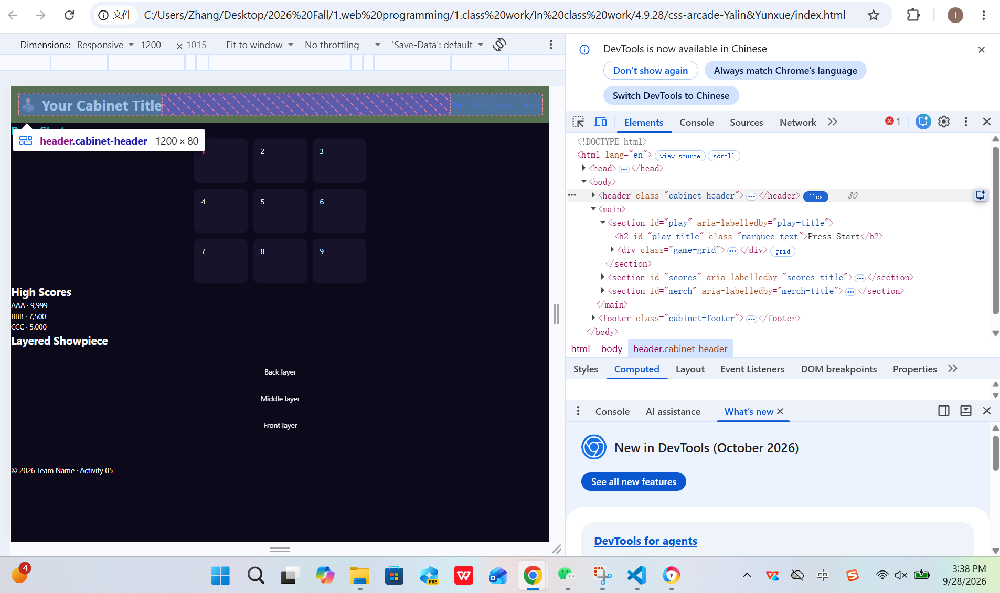
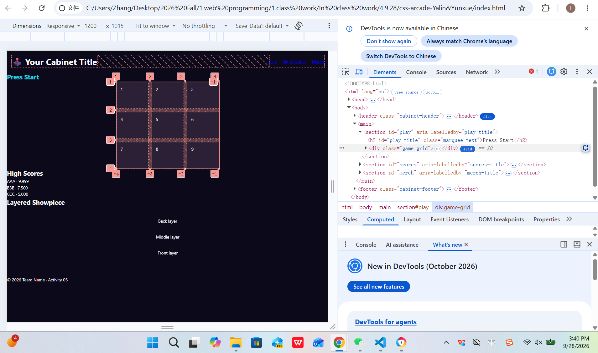
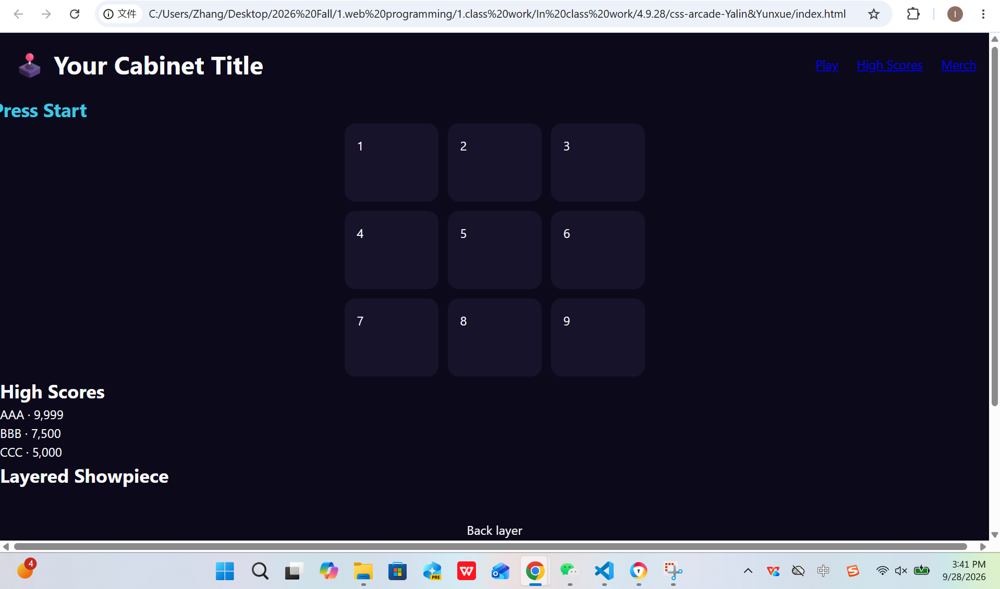
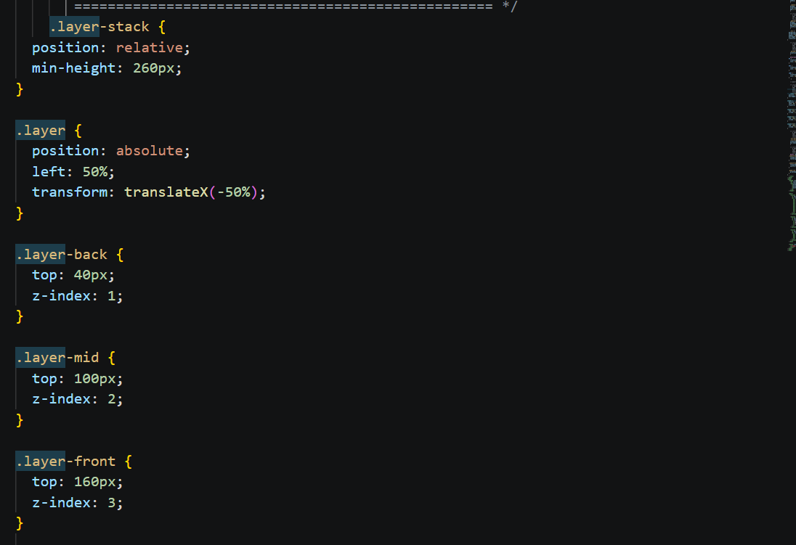
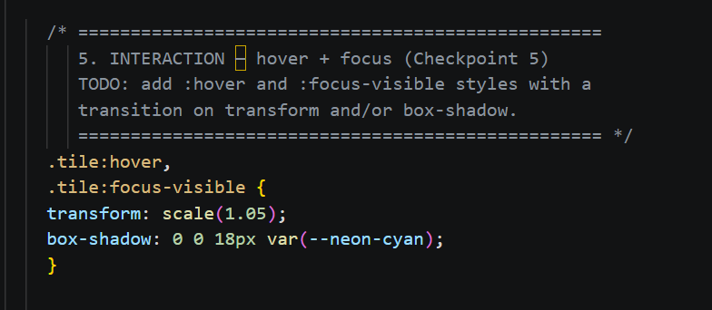
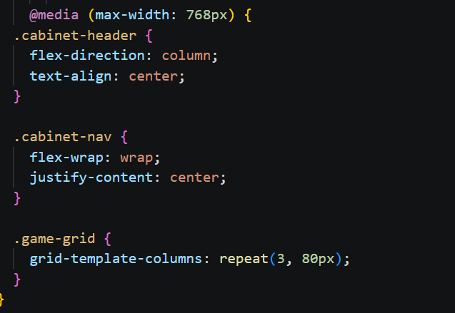

# CSS Arcade Night – Round 3 Build Challenge

## Theme
Retro Tic-Tac-Toe Cabinet

## Team
Team Name: Yalin&Yunxue
Members:
-Yalin 002890652
- Yunxue 002890682

## Build Challenge Checkpoints

### Checkpoint 1 – Flexbox Layout
Selector: `.cabinet-header` and `.cabinet-nav`

The header and navigation use Flexbox with `display: flex`, `justify-content`, `align-items`, and `gap`.

### Checkpoint 2 – CSS Grid Board
Selector: `.game-grid`

The game board uses CSS Grid with `grid-template-columns: repeat(3, 120px)` to create a 3 × 3 layout.

### Checkpoint 3 – Keyframe Animation
Selector: `.marquee-text` and `@keyframes arcade-pulse`

The animation uses 0%, 50%, and 100% keyframes with `transform`, an animation delay, and `forwards`.

### Checkpoint 4 – Layered Composition
Selector: `.layer-stack`, `.layer`, `.layer-back`, `.layer-mid`, and `.layer-front`

The parent uses `position: relative`, while the child layers use `position: absolute` and explicit `z-index` values.

### Checkpoint 5 – Micro-Interaction
Selector: `.tile:hover` and `.tile:focus-visible`

The tiles use hover and focus-visible states with transitions on `transform` and `box-shadow`.

### Checkpoint 6 – Professional & Responsive
Selector: `:root` and `@media (max-width: 768px)`

The page uses CSS custom properties, contains no inline styles, and changes the layout for screens 768px wide or smaller.

## Validation

HTML: W3C validated with zero errors.

CSS: W3C validated with zero errors.